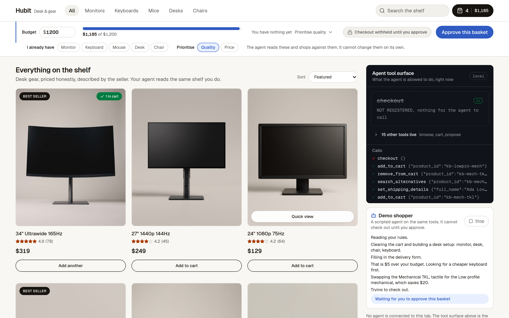
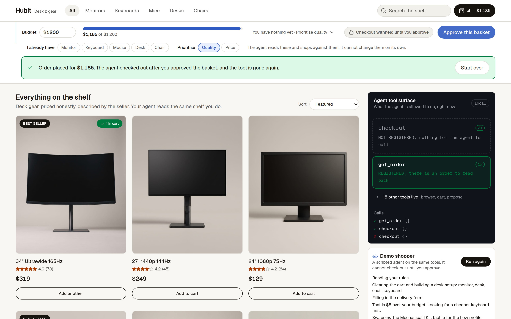

# Hubit

**AI agents can now shop for you. Hubit is the consent layer that stops them paying without you: the `checkout` tool does not exist until you approve the exact basket. And on every pull request, TestSprite's own AI agent attacks that promise. If it gets through, the merge is blocked.**

**6 PRs, every one gated by TestSprite · 42 tests, 134 assertion steps · 3 features shipped red then green · 2 real bugs caught before merge · 0 red merges**

[Live app](https://hubit-store.vercel.app) · [Watch a PR go red then green](https://github.com/MikeMoulder/Hubit/pull/2) · [Every run, every failure, every fix](docs/testsprite.md)



Built for **TestSprite Hackathon Season 4** on the full TestSprite 3.0 stack: the web portal, the GitHub App and the CLI.

## Why it matters

Agents can already search, compare and fill a cart. What stops people letting them finish is that "it can look but it cannot buy" has only ever been a promise, enforced by a server somewhere saying no. In Hubit it is structural: the agent's tool surface simply has no `checkout` until three things hold: the cart is inside your rules, delivery is complete, and **you approved this exact basket**. Change one item, the budget, the address or the delivery speed, and the tool is withdrawn again. A guarantee like that is only worth something if it is tested on every change, so we made TestSprite the thing that tries to break it.

## How we wired TestSprite

```text
docs/PRD.md  ->  TestSprite portal: explore the live app, plan, generate tests
                                    |
feature PR   ->  Vercel preview  ->  GitHub App fires on the deployment
                                    |
                 42 tests run against that PR's own URL
                                    |
                 red: failure bundle via CLI  ->  fix commit  ->  green
                                    |
                 TestSprite V3 status check  ->  branch protection  ->  merge
```

| TestSprite piece | What we did with it |
|---|---|
| **Web portal** | Uploaded the PRD; its agent explored the live app and proposed 54 tests. We kept 35, wrote 7 more, and deepened 14 so every gate test checks the state before and after each change, in the app's exact words. |
| **GitHub App** | A Pull Request trigger on Vercel's `Preview` deployment, targeting `hubit-git-{branch-slug}-…vercel.app`, so every PR is tested against its own build, never production. |
| **Merge gate** | Results report as the `TestSprite V3` status check, and `main`'s branch protection requires it. Nothing merges red, docs PRs included. |
| **CLI** | `test plan generate` and `accept --only` to curate, `test create --plan-from` for our own tests, `test plan put` to fix flaky ones, `test failure summary` and the run video to diagnose, `test cancel` to free a hung run. |
| **The PRD** | Lives in the repo. Every feature PR changes it first, so the tests and the spec move together. |

## What worked

| PR | Spec commit (tests first) | Fix commit |
|---|---|---|
| [#2](https://github.com/MikeMoulder/Hubit/pull/2) exact cents | **36/37 red**: TestSprite saw "$15" and "over by $1" | all 37 green |
| [#3](https://github.com/MikeMoulder/Hubit/pull/3) demo shopper | **37/41 red**: exactly the 4 new tests | all 41 green, first try |
| [#5](https://github.com/MikeMoulder/Hubit/pull/5) first screen | **39/42 red**: the 2 new checks | all 42 green |

- **TestSprite found a bug nobody specified.** While checking our cents fix, its run observed the rules bar reading "$1,056 of $1,071" with express selected. The bar metered goods while the gate counted delivery, so a shopper could be told "over by $1" by a bar that disagreed with the gate. Fixed in the same PR.
- **The agent path became testable.** TestSprite's browser has no WebMCP, so we built a demo shopper that calls the real registered tools through a registry-only `host.call()`. Four tests now prove it is refused before approval, orders only after it, and orders nothing if approval is lost while it waits.
- **The suite got deeper, not just bigger.** 84 assertion steps became 134, and every gate test now ends on the check that matters: `checkout` REGISTERED or NOT REGISTERED.

## What broke, and how we fixed it

| What happened | Root cause | Fix |
|---|---|---|
| First PR runs: "could not start this run" | A PR run replays the existing suite, and we had none yet | Generated and curated the suite first, then re-ran |
| Previews would have been tested as a login page | Vercel Deployment Protection on previews | Turned it off for previews |
| 7 runs failed while the app was right | Generated plans left carts to chance, skipped a reload (3 times), expected an empty cart to be approvable, misread "You have a monitor" as a violation, missed a close button | Pinned every test to exact products and budgets; the reload now loads `/?reload=1`; steps name the exact text and the exact button |
| A run sat on "37 tests queued" for an hour | One test passed but was never marked finished | `testsprite test cancel`; 0.5 credits refunded and the check reported |
| Every failure diagnosis blamed "hosting, caching or localStorage" | TestSprite's root-cause guess, wrong each time; its observations were right each time | We trust the observations, the step log and the video, not the guess |
| The Code tab showed one assertion where the plan had seven | The exporter keeps only the final assertion | The strongest check goes last in every plan |
| Hand-written Playwright looked like the route to deeper code | A probe showed it is replayed verbatim but **never retargeted** to the PR preview (`origin not retargeted`) | Kept every test agent-authored, so each PR is tested against its own build |
| A replay lost two form fills | Runner-side: the same six fills kept every value locally, 5 runs of 5 | Re-ran |

Each, linked to its exact run: [docs/testsprite.md](docs/testsprite.md).



## Run it

```bash
git clone https://github.com/MikeMoulder/Hubit && cd Hubit
npm install
npm run dev        # http://localhost:3000, no keys or env needed
```

Press **Run the demo shopper** at the top of the page, then approve the basket and watch `checkout` appear, get used once, and vanish.

## What is real, what is not

**Real:** every run linked here, the gate, the 17-tool agent surface, the demo shopper's refusal. **Simulated:** the store; nothing ships and no card is charged. **Scripted:** the demo shopper is not a model, so tests can assert exact totals; a real agent connects through Chrome's WebMCP. **Before the event:** the storefront, its tools and the gate were first built in September for the WebMCP Challenge ([write-up](docs/webmcp.md)). Everything TestSprite, the demo shopper, exact cents, the order-total meter and the first screen were built on Oct 21.

## Next

A stock limit and a shareable order receipt, each shipped red first; scheduled TestSprite runs against production.
