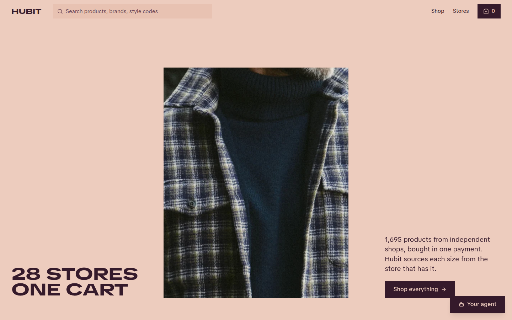
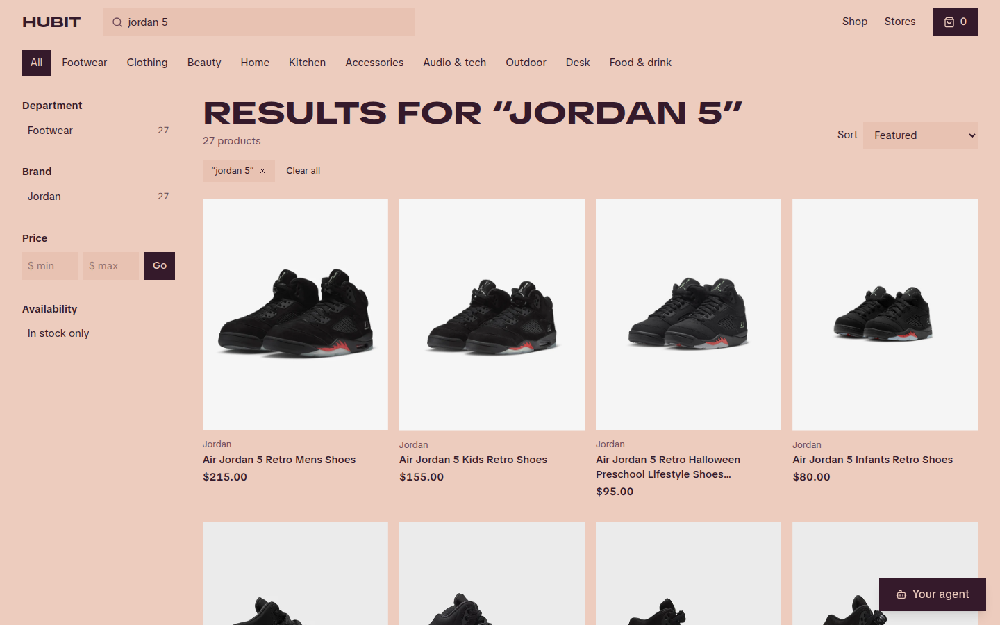
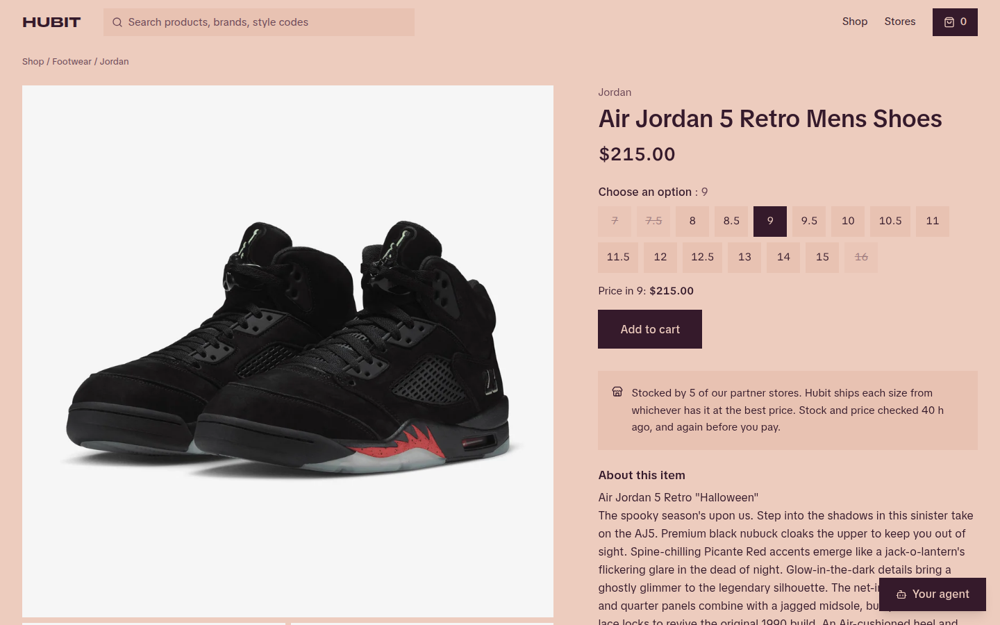
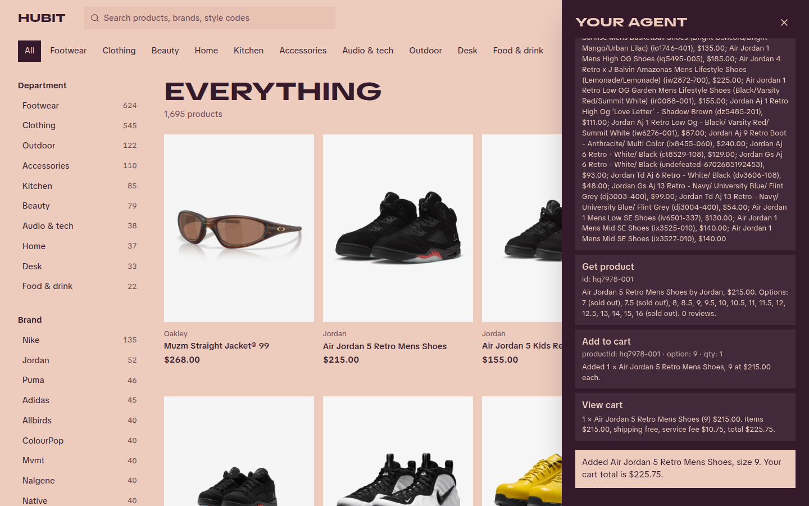
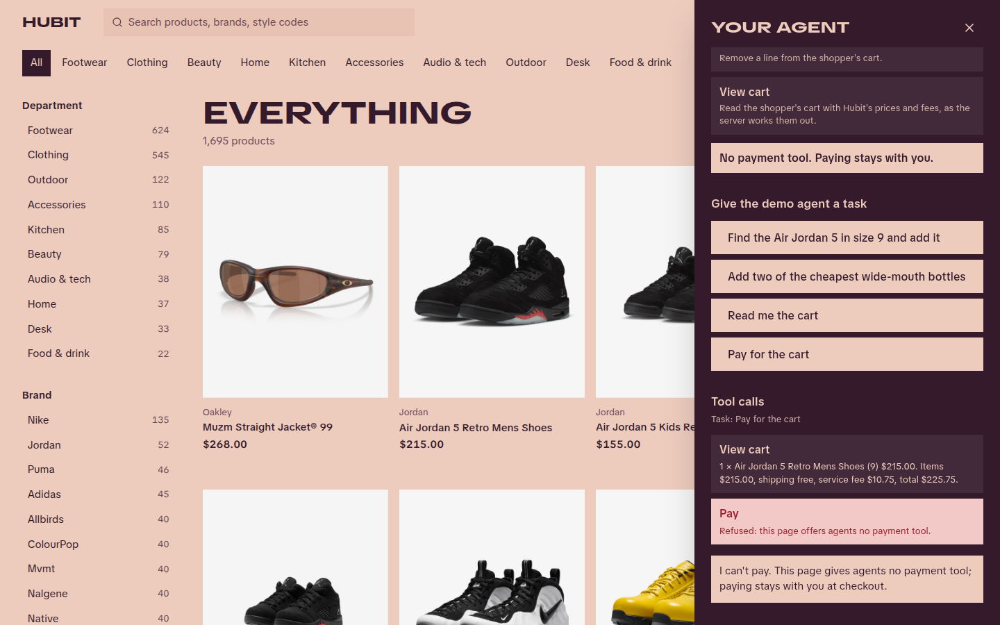
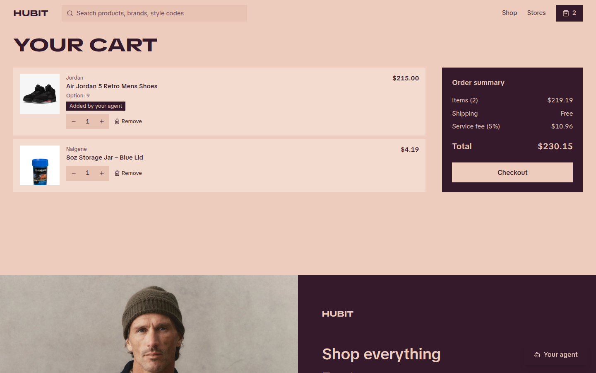
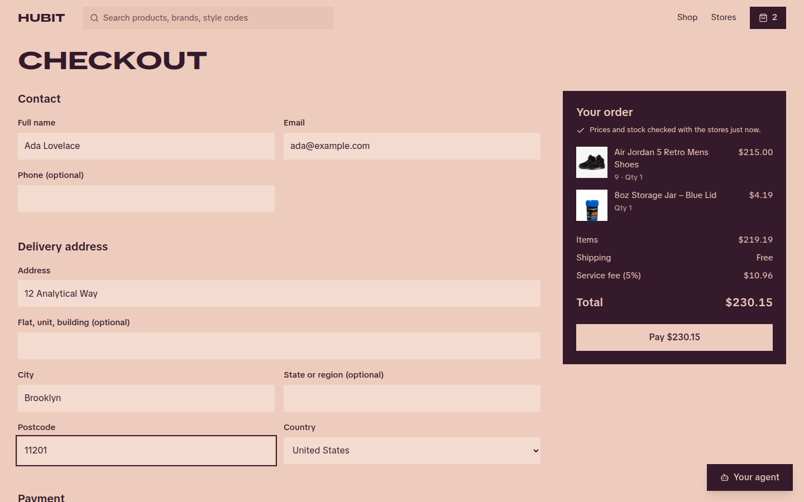
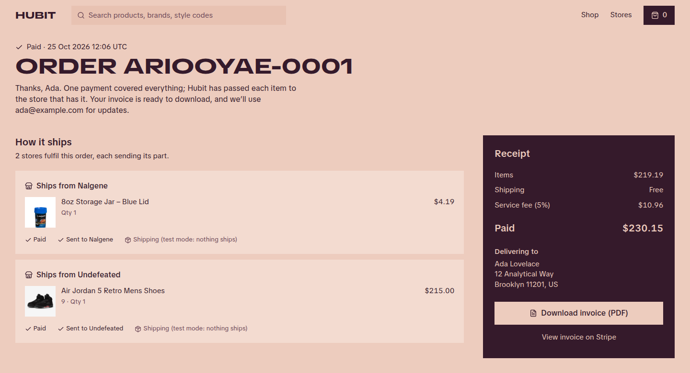
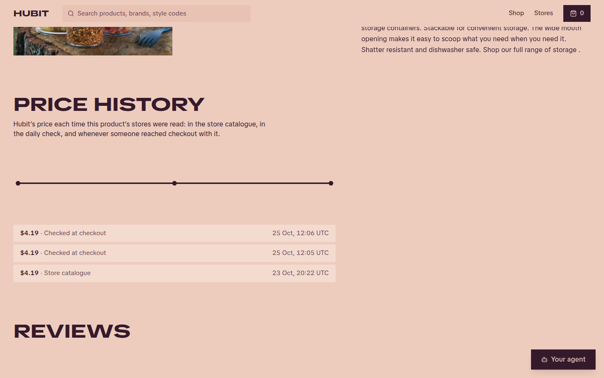
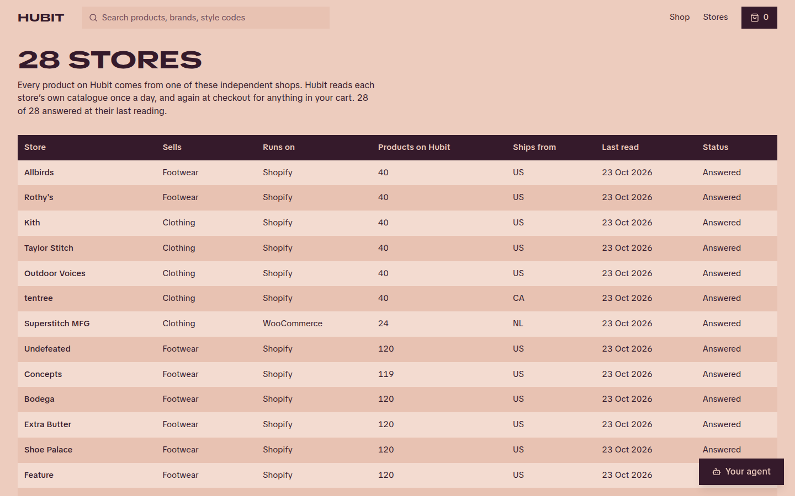

# Hubit

**One shop over 28 independent stores, built for two shoppers at once: you, and your AI agent.** One cart, one payment, one order to follow. Your agent shops through tools the page gives it instead of scraping the screen, and it has no way to pay. Every pull request is tested by TestSprite on its own live preview, and nothing merges until the suite is green.

**[Live app](https://hubit-store.vercel.app)** · **[A PR where TestSprite caught a bug, then went green after the fix](https://github.com/mikemoulder/Hubit/pull/2)** · **[Every run, every failure, every fix](docs/testsprite.md)** · **[Product spec](docs/PRD.md)**

| 1,695 products | 28 stores | 49 TestSprite tests | 152 assertion steps | 13 of 13 PRs gated | 7 bugs caught before merge |
|:-:|:-:|:-:|:-:|:-:|:-:|



Built for **TestSprite Hackathon Season 4**, on the TestSprite 3.0 web portal, the TestSprite GitHub App and the TestSprite CLI.

---

## Contents

1. [The problem](#the-problem)
   - [Problem I: one purchase, many stores](#problem-i-one-purchase-many-stores)
   - [Problem II: agents that can press "Pay"](#problem-ii-agents-that-can-press-pay)
   - [Problem III: agents that have to read a page built for eyes](#problem-iii-agents-that-have-to-read-a-page-built-for-eyes)
2. [The solution: Hubit](#the-solution-hubit)
3. [A walk through the product](#a-walk-through-the-product)
4. [How it works](#how-it-works)
5. [TestSprite: how Hubit is verified](#testsprite-how-hubit-is-verified)
6. [Try it yourself](#try-it-yourself)
7. [Run it locally](#run-it-locally)
8. [What is real, what is simulated, what came before](#what-is-real-what-is-simulated-what-came-before)
9. [What comes next](#what-comes-next)
10. [Repository map](#repository-map)

---

## The problem

Online shopping has two shoppers now. One is a person with a list of things to buy. The other is an AI agent that person has asked to help. Today's stores serve neither of them well, and they fail each one differently.

### Problem I: one purchase, many stores

People rarely shop for one thing. A typical evening's list is a pair of trainers, a water bottle, a jacket for the weekend and a refill of something for the kitchen. Those things almost never live in one store. The trainers are on an independent sneaker shop, the bottle on the maker's own site, the jacket on a third, the kitchen item on a fourth. Each one is its own small, separate world, and the cost of that separation lands entirely on the shopper:

- **Many carts and many checkouts.** The same name, email, address and card are typed again and again, once per store, often with an account to create at each.
- **Shipping charged again and again.** Every store adds its own delivery fee and sets its own free-shipping threshold. A $20 item can cost $27 delivered. Split a basket across four stores and you can pay four delivery fees while never reaching any store's free-shipping minimum.
- **Stock is uneven, and you only find out by checking each store.** The size you need is sold out at one shop and on the shelf at another. In Hubit's own catalogue, the Air Jordan 5 "Halloween" (style code `HQ7978-001`) is sold by **five** stores, and they do not all have the same sizes in stock. A shopper would have to open five sites to learn that size 9 exists at four of them and that size 16 exists at none.
- **The same product, five listings, five prices.** Without matching, the same shoe appears five times with different titles and photos, and comparing them is the shopper's job.
- **Prices drift.** The price seen yesterday is not always the price charged today, and most stores only reveal the change at the last step, or not at all.
- **Many deliveries, many tracking pages.** Four orders mean four confirmation emails, four tracking links, four delivery days and four return policies.

None of this is hard because any one store is badly built. It is hard because **the purchase the shopper has in mind spans stores, and nothing on the web is organised around that purchase.**

### Problem II: agents that can press "Pay"

AI agents now offer to take this work away: "find me those trainers in a 9 and get them ordered." That is the promise. The trust problem underneath it is simple to state:

**On almost every store today, an agent shops through the same page a person does, and whatever the page lets a person do, it lets the agent do, including the final "Place order" button.** The page has no way to tell a click from you apart from a click from software acting on its own reading of what you meant.

That makes the agent's judgement the only thing standing between a request and a charge on your card, and that judgement fails in ordinary ways:

- **It acts out of context.** "Get the cheaper one" can be read as the cheaper store, the cheaper size, or the cheaper product. "Order two" can be read against the wrong line. A misread instruction on a search page wastes a minute; a misread instruction at checkout spends money.
- **It acts on stale information.** The price the agent saw ten minutes ago may not be the price at payment, and an agent racing to finish a task is not the party you want deciding whether a price rise is acceptable.
- **It can be steered by the page itself.** An agent reading a page reads everything on it, including text that was written to instruct it. A store's own content, a review, or an injected banner can push an agent toward a button.
- **"The agent won't pay without asking" is a promise, not a property.** It lives in a system prompt or in the agent's training. Nothing in the store enforces it. When it fails, it fails at the moment it matters most.

The industry's response so far has mostly been to make agent checkout *easier*: new flows that let agents complete purchases on a user's behalf. That solves the agent's convenience, but makes the trust question more urgent, not less. What is missing is a store that lets an agent do everything useful **and makes paying structurally impossible for it**, so the decision to spend money cannot be taken by anyone but the person.

### Problem III: agents that have to read a page built for eyes

Even when an agent does nothing wrong, the way it shops today is slow, brittle and expensive. Websites are designed to be looked at. An agent has to reconstruct meaning from them:

- **It reads everything to find one thing.** To learn a single price, a page-reading agent loads the whole page, its markup or a screenshot of it, and works out which number is the price. Every step of a shopping task repeats that: search page, product page, size picker, cart. Each step costs time and tokens, and the cost multiplies with every store the purchase spans. Five stores for one shoe is five rounds of reading.
- **Meaning is often visual only.** A sold-out size is a struck-through button. A rating is five star icons. A selected option is a darker square. People see these instantly; an agent reading the page has to infer them, and often cannot.
- **It is ambiguous.** "Add to cart" can be a button, a link or an icon; the price on a card might be the sale price or the old one; a "9" on the page might be a size or a quantity.
- **It is brittle.** A redesign, a renamed class, a cookie banner or a pop-up breaks the agent's understanding of the page, and nothing tells the agent it has broken.

This is not a theoretical concern for us. **TestSprite's own test agent, which reads pages the way shopping agents do, tripped on exactly these problems while testing Hubit.** It could not read a review's star rating because the rating was drawn only as icons, and it could not read "Page 2 of 71" because the label was rendered as four separate pieces of text. Both are described in the [TestSprite section](#bugs-testsprite-caught-before-they-merged). If a purpose-built testing agent misses meaning that is only visual, a shopping agent will too.

---

## The solution: Hubit

**Hubit is a store aggregator built for two shoppers at once.** As far as we know it is the first to treat an AI agent as a first-class shopper on the same page as the person it works for. For the person, it turns many stores into one shop. For the agent, it replaces reading the page with calling tools the page provides, and it leaves out the one tool an agent should never have: paying.

**Hubit is the merchant.** The shopper buys from Hubit, in one cart and one payment. Behind the scenes Hubit sources each item from an independent store that has it, at the best price. Items are sold at each store's own price. Hubit earns its margin from two fees, both printed before you pay: **shipping, $6.99 per order (free from $75.00)**, and a **5% service fee** on the items.

### How Hubit answers Problem I (people)

| The problem | What Hubit does |
|---|---|
| Many stores, many catalogues | **One catalogue.** Real products, prices, stock and photos read from **28 independent stores**, plus customer reviews from the stores that publish them, on Shopify and WooCommerce, normalised into one shape: **1,695 products** in **10 departments**. |
| The same product listed five times | **One product, however many stores sell it.** Listings are matched on the manufacturer's style code (for example `HQ7978-001`). The Air Jordan 5 is one product with one price, **$215.00**, not five near-duplicates. **33 products** are sold by more than one store. |
| Your size is in stock somewhere, but where? | **Sizes pooled across stores.** The product page lists every size any store has. A size sold out at one store is still buyable if another has it. A size sold out everywhere is shown struck through and cannot be chosen. |
| Choosing which store to buy from | **Routing per item, per size.** Each line goes to the store that has that size in stock at the lowest price. The shopper never picks a store. Size 9 can come from one shop and size 11 from another. |
| Many carts, many checkouts | **One cart, one checkout, one payment.** One form, one card, one Stripe invoice, whatever the number of stores behind it. |
| Delivery fees stacked per store | **Two fees, the same everywhere, charged once per order.** No per-store shipping. |
| Prices that change by the time you pay | **Checked again before you pay.** At checkout Hubit reads every item from its stores again. A price rise is shown and the total updates before you can pay. A sell-out blocks payment until the item is removed. If the cheapest store sold out of your size but another still has it, Hubit re-routes silently at the same price. **Nothing is ever charged on a total you did not see.** |
| Many orders to track | **One order page.** Everything you bought, grouped by the store sending each part, with one receipt and a downloadable invoice. |
| Is this store reliable? Is this price normal? | **A Stores page and price history.** Every source store is listed with its platform, product count, country and whether it answered at its last reading. Every product shows Hubit's price each time its stores were read. |

**Delivery, honestly.** Today one Hubit order can arrive as more than one parcel, because each store ships its own part. Hubit gives you one order, one receipt and one place to follow it. Consolidating parcels into a single delivery is the natural next step ([What comes next](#what-comes-next)), and the demo does not claim to do it.

### How Hubit answers Problems II and III (agents)

Hubit adopts **WebMCP**, an emerging browser standard that lets a web page register **tools** with the AI agent built into the browser. A tool is a named action with a description and an input schema. The agent calls it like a function and gets exact data back. There is nothing to scrape.

Hubit's page registers five tools:

| Tool | What it does | What it returns |
|---|---|---|
| **Search catalog** | Search all 28 stores' products by words, department, price, stock, sort | Titles, ids, brands and prices to the cent |
| **Get product** | Read one product | Price, every size with its stock status ("7 (sold out)"), description, reviews |
| **Add to cart** | Add a product and size to the shopper's cart | The added line, marked as added by the agent |
| **Remove from cart** | Remove a line from the shopper's cart | A confirmation, or why the line could not be removed |
| **View cart** | Read the shopper's cart | Lines, items, shipping, service fee and total, as the server works them out |

What that changes:

- **No payment tool, by design.** The agent can search, compare and fill the cart. It cannot pay, check out or see card details, **because no such tool exists on the page**. This is a structural limit, not an instruction the agent might ignore, misread or be talked out of. Ask the agent to pay and the attempt is refused in the log: *"Refused: this page offers agents no payment tool."* **Paying stays with the person, at checkout.**
- **One page, one cart, two shoppers.** The agent works inside the shopper's own session, not in a separate store for machines. What it adds lands in the shopper's cart immediately, marked **"Added by your agent"**. What the shopper changes, the agent sees the next time it looks. There is no second API to build, secure and keep in sync with the site people use.
- **Exact data instead of inference.** A sold-out size is `"available": false` in the tool result, not a struck-through button. A price is a number in cents, not a string the agent has to find. A rating is a number, not five icons.
- **One call instead of a page read.** Finding a product across 28 stores is one Search catalog call returning compact results, not five sites, five search pages and five product pages read in full.
- **Same server, same rules.** The tools use the same server APIs the pages use. Every price, fee and total an agent sees is worked out by the server, so the agent and the person always see the same numbers.
- **Works today, even without WebMCP.** Most browsers do not support WebMCP yet. In those, the **"Your agent"** panel lists the same tools and runs a demo agent that calls them through the same registry a real agent would use, step by step, with every call and result in a log. Anyone can watch it work, and so can a test runner.

---

## A walk through the product

**Search 28 stores at once.** One search box covers every store. Search matches the product's title, brand, the store's own tags, department and style code, never a word mentioned in passing in a description. Filters for department, brand, price and stock, with removable chips and four sorts.



**One product, sizes from every store.** The Air Jordan 5 is stocked by five stores. Its page shows one price and every size any of them has. Sizes 7, 7.5 and 16 are sold out everywhere and struck through. The note under the button says how many partner stores stock it and that the price is checked again before payment.



**Your agent, using tools.** Give the demo agent a task and watch each real tool call: its name, its input and its result. Here it searched, read the product, added size 9 and read the cart back.



**…and refused at the one thing it must not do.** Asked to pay, the agent looks for a payment tool, finds none, and says so. The cart is unchanged and no order exists.



**One cart for both of you.** The shoe the agent added sits next to the jar the shopper added, marked "Added by your agent". Fees are worked out by the server: here the items pass $75, so shipping is free and the 5% service fee is $10.96.



**Checked with the stores before you pay.** The order panel is built from a fresh reading of every store involved: "Prices and stock checked with the stores just now."



**One payment, split behind the scenes.** This order was paid on the live site with Stripe's test Visa while this README was written. One payment of $230.15; the jar ships from Nalgene and the shoe from Undefeated; one receipt and a Stripe invoice.



**Price history and the stores behind every product.** Every time a product's stores are read (the original store catalogue, the daily store check, every checkout) the reading is recorded and shown on the product page. The Stores page lists all 28 sources.





---

## How it works

```text
 28 stores (24 Shopify, 4 WooCommerce)
        │  adapters: /products.json?country=US, /meta.json, WC Store API, reviews
        ▼
 normalise ─ filter junk ─ convert AUD/EUR at the day's rate ─ match style codes
        │
        ▼
 frozen catalogue snapshot (1,743 listings → 1,695 products, 118 reviews)
        │
        ├──► pages: /, /shop, /p/[id], /cart, /checkout, /orders/[id], /stores
        │       └─ "Your agent" panel ─► tool registry ─► WebMCP (document.modelContext)
        │                                    │
        ├──► APIs: /api/search, /api/products/[id], /api/cart/quote   ◄── tools and pages
        │
        ├──► /api/checkout/review ── re-check every line ── live stores (production)
        │                                                └ snapshot + drift file (previews, tests)
        │
        ├──► /api/checkout/pay ── re-check again ── Stripe invoice ── pay ── order page
        │
        └──► Supabase Postgres: price readings, orders and lines, store status, sync runs
                 ▲
                 └── Vercel Cron, daily 06:00 UTC: /api/cron/sync reads every store
```

### The catalogue: from 28 storefronts to one shop

- **Source adapters.** Shopify stores are read through `/products.json`, WooCommerce stores through the WooCommerce Store API, plus each WooCommerce store's product reviews. One polite fetch layer sends an honest user agent, enforces a timeout, and turns an HTML bot wall into a readable error instead of a JSON crash ([`adapters/http.ts`](src/server/catalog/adapters/http.ts)). A failing store is recorded and skipped, never fatal.
- **Real-world data problems, solved:**
  - **Geo-priced storefronts.** Shopify prices for the requester's market. Read from a European server, the Air Jordan 5 came back at $240 instead of $215. Every read is pinned to the US market (`&country=US`).
  - **Store currency.** A store's base currency is read from its `/meta.json`, not from the cart, which is localised to the visitor too. AUD and EUR stores are converted at the day's rate.
  - **Junk listings.** Gift cards, samples, return labels, spare parts, shipping protection and CMS placeholders are filtered out before they reach the shelf.
  - **Money without floats.** "220.00" becomes 22000 cents by string arithmetic, never by multiplying a float.
  - **HTML descriptions** are reduced to plain text, entities decoded, and trimmed at a word boundary.
- **Matching.** Products across stores are joined on the manufacturer's style code (`HQ7978-001`-style codes, Oakley `OO` codes). One product holds every store's offer.
- **Routing.** For each line and size, the in-stock offer with the lowest price wins ([`routing.ts`](src/server/catalog/routing.ts)).
- **A frozen snapshot.** The catalogue is a snapshot of all 28 stores taken on 23 Oct 2026 ([`data/catalog-snapshot.json`](data/catalog-snapshot.json)). Every deployment serves the same products at the same prices, so the spec and the tests can state exact numbers and every one of them holds.

### Money: the browser holds choices, the server holds prices

The browser's cart holds only what was chosen: product, size, quantity, and who added it (you or your agent). Every price, fee, source and total is worked out by the server in `/api/cart/quote`, to the cent and in integers. The 5% fee rounds half-up on whole cents (5% of $10.10 is 50.5¢, charged as 51¢). Nothing the browser holds can change what is charged.

### The pre-payment re-check

Before payment, every line is read again from its stores ([`recheck.ts`](src/server/checkout/recheck.ts)):

- **Production** reads each store's live product endpoint.
- **Previews and tests** read the snapshot plus a small committed **drift file** ([`data/recheck-drift.json`](data/recheck-drift.json)) describing what the stores "changed" since: one bottle went up from $18.99 to $21.99, one desk item sold out everywhere, and the Air Jordan 5 in size 9 sold out at Undefeated only. That makes every branch of the re-check (price up, sold out, silent re-route) deterministic and testable on every PR, against real catalogue data.
- **A store that cannot be reached keeps its last reading** rather than vanishing from the order.
- The pay endpoint **re-checks again** at the moment of payment. If anything moved between review and pay, nothing is charged and the shopper is asked to check the new total.

### Payment: a real Stripe invoice per order

Hubit runs on Stripe **test keys only**; the server refuses to start a payment with anything that is not `sk_test_`. Each order becomes a Stripe customer and an **invoice**. Every line carries the store it was routed to in its metadata, plus shipping and the service fee as their own lines. If the finalised invoice's total ever differs from the server's quote by a single cent, **the invoice is voided and nothing is charged**. The shopper chooses what the test card does: Stripe's own test cards for a Visa that pays, a card that is declined, and one with insufficient funds. Declines are real Stripe declines, and the cart is kept.

Hosted Stripe Checkout was considered and rejected: its payment iframe cannot be driven by an automated tester, and testing the payment path end to end on every PR mattered more.

### The agent: one registry, one surface

[`src/lib/agent/webmcp.ts`](src/lib/agent/webmcp.ts) is the only file that touches `document.modelContext`. Every tool is registered there with an `AbortController`, so removing a tool really removes it from the browser's agent. The panel and the demo agent read from the **same registry**, so the demo agent can never do anything a real agent could not. Each tool validates its own input, because `inputSchema` is not validated by the browser. That is one of [the WebMCP behaviours we measured](docs/webmcp-findings.md) rather than assumed, in Chrome and in ChatGPT's in-app browser.

### Data: Supabase Postgres

- **`price_points`**: every reading of every offer, tagged with its origin (store catalogue, daily check, checkout) and the environment that wrote it, so readings from previews never mix into production's history.
- **`orders`, `order_lines`**: every paid order and the store each line was routed to.
- **`source_status`, `sync_runs`**: each store's last attempt, last success, last error and listing count.
- A **daily Vercel Cron** job at 06:00 UTC reads every store (bounded concurrency, a 35-second budget, about 22 seconds in practice) and records the results. The job is protected by a bearer secret.
- If the database is missing or fails, the shop keeps working: reads fall back to empty and the error is logged ([`db/index.ts`](src/server/db/index.ts)).

### Stack

Next.js 16 (App Router, server components), React 19, TypeScript, Tailwind CSS v4, Stripe (test mode), Supabase Postgres via `postgres`, Vercel (hosting, previews, cron), WebMCP. Node's built-in test runner for local tests. No authentication: every flow works for an anonymous visitor.

---

## TestSprite: how Hubit is verified

Hubit's claims are specific: "$225.75, not $225", "size 9 ships from Undefeated", "the agent cannot pay", "nothing is charged on a total you did not see". Claims like that are only worth something if they are checked on every change, by something that uses the app the way a person would. That is TestSprite's job here.

**TestSprite is the gate every change passes through.** On every pull request, TestSprite's agent opens that PR's own live Vercel preview in a real browser and runs the whole suite: 49 tests, 278 steps, 152 of them assertions. It shops, filters, fills carts, pays with Stripe test cards, gives the demo agent tasks and reads the results. It reports back on the PR as a comment and as the `TestSprite V3` status check, and **GitHub refuses the merge until that check is green**. Docs-only PRs included.

### The wiring

| Piece | Setting | Why |
|---|---|---|
| TestSprite project | Frontend project `hubit` in the TestSprite 3.0 portal, environment pointed at https://hubit-store.vercel.app, no sign-in | Hubit has no accounts; every flow works for an anonymous visitor |
| Spec | [`docs/PRD.md`](docs/PRD.md), uploaded to the project and kept in the repo | TestSprite plans from the PRD, so the PRD changes in the same PR as the behaviour it describes |
| GitHub App | Installed on this repo, Pull Request trigger | Every PR is tested, not just `main` |
| Trigger event | Vercel's `Preview` deployment for the PR | Fires once the PR's preview exists, so the run tests that PR's build |
| Target URL | `hubit-git-{branch}-….vercel.app` | Each PR is tested against its own build, never production |
| Blocking PRs | On: results are reported as the `TestSprite V3` status check | A failing run marks the PR red |
| Branch protection | `main` requires `TestSprite V3` | Nothing merges red |
| Vercel Deployment Protection | Off for previews | With it on, previews answer with a Vercel login page and TestSprite would test that instead |
| CLI | `@testsprite/testsprite-cli` 0.15.0 | Plan curation, plan edits, single-test runs and failure bundles from the terminal, alongside the portal |

```text
 docs/PRD.md ──► TestSprite portal: explore the live app, plan, generate the suite
                                   │
 pull request ──► Vercel preview ──► TestSprite GitHub App fires on the deployment
                                   │
                  49 tests run against that PR's own URL, in a real browser
                                   │
          red ──► comment + failure bundle (steps, screenshots, video) ──► fix commit ──► re-run
                                   │
          green ──► TestSprite V3 check passes ──► branch protection allows the merge
```

### How the suite was built

1. **Generated from the live app.** The portal's agent explored the live app with the PRD as its source and proposed **54** tests.
2. **Curated.** About a third were duplicates. One scenario appeared four times. Every PR run replays the whole suite at about 0.5 credits a test, so each duplicate would be paid for on every push. We kept **36**, one per distinct scenario.
3. **Extended and deepened.** We wrote more tests as plan files and created them with `test create --plan-from`. We then rewrote the shallow ones so each states the app's exact words and numbers before and after every change, and ends on its strongest check.
4. **Carried forward, not thrown away.** When Hubit grew from a single store (v1) into the multi-store shop (v2), the 42 tests were **rewritten in place**: same test ids, run history kept, new plans for the new product ([v1 plans archived](docs/testsprite-v1/)).
5. **Grown test-first.** Every new v2 feature arrived in a PR whose first commit was only the spec and its new tests, so the suite went red on exactly those tests before the feature existed: 4 agent tests (46 total), then 3 stores and price-history tests (49 total).

### What the 49 tests cover

| Area | Tests | What they prove |
|---|---:|---|
| Catalogue, search and filters | 11 | 1,695 products, 24 a page, "Page 2 of 71"; department counts (Footwear 624); search by title, brand or style code ("HQ7978-001" finds exactly 1); "mug" finds 5, not the coffees that merely mention a mug; both price sorts with their exact first products; brand and price filters with removable chips; header on every page; unknown product is a 404 |
| Home | 3 | The first screen says what Hubit is; "Try a size" names the store and price ("Size 9: in stock at 5 of 5 stores. Hubit ships it from Undefeated at $215.00"); department rows link to their shelves |
| Product and sizes | 5 | Sizes pooled from every store; sizes sold out everywhere (7, 7.5, 16) cannot be chosen or bought; Add to cart disabled until a size is chosen; reviews come from the stores' customers, each with a name and a date, and a bare initial reads "Verified buyer T." |
| Cart | 8 | Add, add again (quantity rises), steppers, remove one line, empty state, the chosen size kept on the line, the cart survives a reload, browsing never changes the cart |
| Money | 4 | Every amount to the cent; free shipping at exactly $75.00 ($75.96 free, $37.98 pays $6.99); the 5% fee rounded to the cent; the cart's fees match the ones printed on the home page |
| Checkout and the re-check | 5 | The $18.99 → $21.99 price rise is shown and the total becomes $53.17; a size sold out at one store re-routes silently at $225.75; a product sold out everywhere disables Pay until removed, then the order goes through at $11.39; no checkout with an empty cart |
| Details and payment | 6 | Invalid email and required fields refused; Visa pays and the order page shows Paid; one payment split between Extra Butter and Nalgene, Paid $271.93; declined card and insufficient funds charge nothing and keep the cart |
| Your agent | 4 | Finds a product and adds it (four logged tool calls, total $225.75); cannot pay (refused, cart unchanged, no order); you and your agent fill one cart (only the agent's line marked, total $36.57); the agent sees what you change |
| Stores and price history | 3 | The Stores page lists 28 stores with platform, product count and status; a product's history starts at the store catalogue (23 Oct); a price change seen at checkout appears in that product's history with a "Latest store reading" note |

Plans are in the repo: [`v2-plans.py`](test/testsprite/v2-plans.py), [`agent-plans.py`](test/testsprite/agent-plans.py), [`stores-plans.py`](test/testsprite/stores-plans.py).

**How the tests are designed:**

- **Exact numbers from the spec.** The PRD states worked examples to the cent ($46.87, $53.17, $225.75, $271.93), and the tests assert them. A total that is off by a cent fails.
- **Deterministic against real data.** The snapshot and the drift file mean the catalogue and the stores' "changes" are identical on every preview, so a test can say "the bottle rose to $21.99" and be right every time, while still exercising real catalogue data and real Stripe test payments.
- **Before and after.** Tests check the state before a change and after it, in the app's own words, so a test cannot pass by finding the right text on the wrong page.
- **Nothing left to chance.** A generated plan that says "add items until the cart is near the budget" is a coin toss. Every test that touches a total names its products and quantities.
- **The strongest check goes last.** TestSprite's exported code keeps the final assertion most visibly, so each plan ends on the claim that matters most.

### Every pull request, red then green

All 13 pull requests in this repo carry the TestSprite check, and every one was merged green. Seven show the loop working: the check went red, a fix was pushed **to the same PR**, and it went green. TestSprite's bot replaces its comment on every push, so each of these PRs also has a comment recording its red runs with links to the reports.

| PR | What it shipped | TestSprite, run by run |
|---|---|---|
| [#1](https://github.com/mikemoulder/Hubit/pull/1) | The PRD and the first suite (v1) | could not start (no tests yet) ×2 → 35/36 → 35/36 → **36/36** |
| [#2](https://github.com/mikemoulder/Hubit/pull/2) | Money to the cent (test-first) | **36/37** (caught "$15" and "over by $1") → 35/36 → **37/37** |
| [#3](https://github.com/mikemoulder/Hubit/pull/3) | A demo shopper (test-first) | **37/41**, exactly the 4 new tests → **41/41** on the first run |
| [#4](https://github.com/mikemoulder/Hubit/pull/4) | v1 README | **41/41** (docs PRs are held too) |
| [#5](https://github.com/mikemoulder/Hubit/pull/5) | A first screen that explains itself (test-first) | **39/42** → 41/42 → **42/42** |
| [#6](https://github.com/mikemoulder/Hubit/pull/6)–[#9](https://github.com/mikemoulder/Hubit/pull/9) | Docs and a WebMCP fix | 41/42 → 42/42; 42/42 ×2; 41/42 → 42/42; 42/42 |
| [#10](https://github.com/mikemoulder/Hubit/pull/10) | **Hubit v2**: one shop over 28 stores | **40/42** (caught 2 real bugs) → 41/42 → **42/42** |
| [#11](https://github.com/mikemoulder/Hubit/pull/11) | **Shop with your agent** (test-first) | **42/46**, exactly the 4 new tests → 45/46 → 45/46 → **46/46** |
| [#12](https://github.com/mikemoulder/Hubit/pull/12) | **Stores and price history** (test-first) | **46/49**, exactly the 3 new tests → **49/49** |
| [#13](https://github.com/mikemoulder/Hubit/pull/13) | Ledger (docs only) | **48/49**: a docs PR caught a real bug in merged code → fix → **49/49** |

**The best single example: [PR #11](https://github.com/mikemoulder/Hubit/pull/11).** It opened with only the spec and four agent tests, and TestSprite went red on exactly those four while all 42 existing tests passed. The feature landed and all four agent tests passed. In the same run TestSprite flagged that review ratings could not be read, then on the next run that the page number could not be read. Each was fixed on the same PR, and the fourth run was 46/46.

### Bugs TestSprite caught before they merged

| # | Where | What TestSprite saw | What was wrong | Fix |
|---|---|---|---|---|
| 1 | PR #2 | Express delivery shown as "$15"; a cart $0.99 over budget shown as "over by $1" | Money was checked in cents but shown rounded to the dollar | Money always shown to the cent |
| 2 | PR #2 | "The rules bar displayed $1,056 of $1,071" with express selected | **Not in any test.** TestSprite noticed it while checking something else: the bar measured goods while the gate counted delivery too | The bar measures the whole order |
| 3 | PR #10 | Searching "mug" and removing the Kitchen filter listed coffees, a jacket and a suncatcher | Search matched product descriptions, so a word mentioned in passing ("enjoy with your morning mug") made a match | Search matches title, brand, tags, department and style code only |
| 4 | PR #10 | A review credited to "T" read as a missing name | Some stores give a reviewer's initial only | Short names read "Verified buyer T." |
| 5 | PR #11 | Five reviews with names and dates, but no individual ratings, only the product's overall 5.0 | Each review's rating was drawn as star icons only, with no text: invisible to a page-reading agent and to screen readers | Each review shows its rating as text ("5/5") beside the stars |
| 6 | PR #11 | On page 2: "Previous", "Next" and "71 pages", but no current page number | "Page 2 of 71" was rendered as four separate text nodes, which the reading agent did not join | One text string, marked `aria-current="page"` |
| 7 | PR #13 | The product's price history no longer showed its first, store-catalogue reading | The list showed the newest 8 readings; 16 checkout readings from earlier test runs had pushed the starting point out. A bug that only appears with use | The first reading always stays, after a "9 more readings" line |

Bug 7 is worth dwelling on. PR #13 changed only documentation. TestSprite ran the full suite anyway, and the suite caught a bug in code merged one PR earlier, one that only appeared because the product had been through checkout enough times. **That is the case for running everything on every PR.**

Bugs 5 and 6 are the agent problem from [Problem III](#problem-iii-agents-that-have-to-read-a-page-built-for-eyes), observed first hand. A testing agent that reads pages missed meaning that was only visual or only implied by layout. We fixed both for people using screen readers and for page-reading agents. We also took them as evidence for Hubit's thesis: agents should get data through tools, not reconstruct it from pixels.

### When the test was wrong, not the app

Not every red run was a bug in Hubit. Reading TestSprite's step log, screenshots and run video told us which was which, and we fixed the plan instead of the app when the app was right:

- **Plans that left choices to the agent.** "Add items so the cart is near budget" let the agent pick a cart that could never reach the condition. Every total-related test now names its exact products and quantities.
- **Steps the agent treated as no-ops.** "Reload the page" was skipped three times. The test now navigates to a different URL (`/?reload=1`) that forces a full load.
- **Clicks that missed.** A blocked run's last video frame showed a drawer still open because the close click had missed. Plans now name the exact control ("the X in its top-right corner") and confirm the drawer has gone.
- **Off-plan wandering.** On PR #10 a filter test passed every check, then its agent tried to remove a chip the plan never mentioned and stalled. The removal is now an explicit step.
- **Misread summaries.** The agent read a settings summary as a violation message. Steps now quote the exact text expected, and the text that should remain.

What generalised: **TestSprite's observations were accurate every time; its root-cause guesses were not.** For every test-design failure, the failure bundle's hypothesis blamed hosting, caching or a stale build. The step log and the video told the real story, so those are what we read.

### TestSprite issues we hit, and what we did

- **First PR runs "could not start".** A PR run replays the existing suite, so a project with no tests yet fails before it starts. We built the suite first, then re-ran.
- **A run that never finished.** One test passed all its steps but stayed "running" for over an hour, holding the check on "37 tests queued". `testsprite test cancel` released it, the 0.5 credits were refunded, and the check reported the real result.
- **Hand-written test code is not retargeted.** Code stored with `test code put` is replayed verbatim against whatever URL it names, so hand-written tests would silently check production on every PR. We kept every test agent-authored, so each follows the PR's preview URL, and made the plans deep instead.
- **Vercel Deployment Protection** would have made TestSprite test Vercel's login page and charge for it. We turned it off for previews.
- **A replay that lost input.** One run recorded six form fills as passed, but the video showed two fields empty. The same sequence in headless Chrome kept every value five times out of five; a rerun passed.

### Cost discipline

A full PR run costs about 0.5 credits per test, so about 24.5 credits for 49 tests, on every push. That shaped the suite: duplicates were cut at generation time; new tests are added only for new behaviour; failures are diagnosed with single-test runs before a fix is pushed; and red runs are recorded on the PR rather than re-run. The full history, with every run's id, commit and result, is in **[docs/testsprite.md](docs/testsprite.md)**.

### Alongside TestSprite: local tests

`npm test` runs 13 fast tests with Node's built-in runner: catalogue integrity, fee arithmetic and rounding, routing per size, search relevance, reviewer names and the re-check's branches. They run before every push. TestSprite then runs the product end to end, in a browser, on the real preview.

---

## Try it yourself

On **https://hubit-store.vercel.app**:

1. **Search** "jordan 5", open **Air Jordan 5 Retro Mens Shoes**, notice sizes 7, 7.5 and 16 struck through, choose **9** and add it.
2. **Give your agent a task.** Press **Your agent** (bottom right) → **Add two of the cheapest wide-mouth bottles**. Watch the tool calls, then open the cart: the bottles are marked "Added by your agent".
3. **Try to make it pay.** In the agent panel, choose **Pay for the cart**. It is refused; nothing changes.
4. **Check out.** Fill any name, an email like `name@example.com`, and an address. Choose a test card:
   - **Visa ending 4242** pays. The order page shows which store sends each part, the receipt and a Stripe invoice PDF.
   - **Card that is declined** or **Card with insufficient funds**: refused by Stripe, nothing charged, cart kept.
5. **See the stores.** Header → **Stores**: 28 stores and how each answered at its last reading. Open any product and scroll to **Price history**.

No real card is ever charged and nothing ships. On the live site the re-check reads the stores live. The scripted store "changes" (the $21.99 bottle, the sold-out desk item, the size 9 re-route) appear on PR previews and when running locally, where the drift file is used.

## Run it locally

```bash
git clone https://github.com/mikemoulder/Hubit && cd Hubit
npm install
# create .env.local with the variables below
npm run dev                  # http://localhost:3000
npm test                     # 13 local tests
```

| Variable | Needed for | Notes |
|---|---|---|
| `STRIPE_SECRET_KEY` | Paying | Must be a Stripe **test** key (`sk_test_…`); anything else is refused |
| `POSTGRES_URL` | Price history, orders, store status | Optional: without it the shop works and history is empty. Create the tables with `node scripts/db-setup.ts` |
| `CRON_SECRET` | The daily sync endpoint | Optional locally |
| `HUBIT_RECHECK` | Re-check mode | `snapshot` (default outside production) or `live` |

`npm run snapshot` re-reads all 28 stores and rewrites `data/catalog-snapshot.json`.

---

## What is real, what is simulated, what came before

- **Real:** the 28 stores and their products, prices, sizes and photos, and the reviews of the stores that publish them (all read from public storefront endpoints); Stripe test-mode customers, invoices, charges and declines; the live pre-payment re-check in production; the daily store sync; every TestSprite run, comment and status linked in this README.
- **Simulated:** fulfilment. Hubit has no agreements with these stores. Nothing is bought from them and nothing ships; the order page says "test mode: nothing ships". The drift file simulates store changes on previews so tests are deterministic.
- **Scripted:** the demo agent is not a language model. It runs fixed scripts of real tool calls, so its behaviour can be asserted exactly. A real agent connects through WebMCP in a browser that supports it, and gets the same five tools.
- **What came before the event:** an earlier, single-store version of Hubit and its WebMCP tool layer date from early September 2026 ([write-up](docs/webmcp.md), [measured findings](docs/webmcp-findings.md)). During the event (21–25 Oct) we wired TestSprite end to end, built and curated the suite, and then **rebuilt Hubit as the multi-store aggregator**: adapters for 28 stores, matching, routing, fees, the re-check, Stripe invoices, the agent panel on the new shop, Supabase, the daily sync, the stores page and price history. That rebuild is 24 commits, all of them merged through TestSprite-gated PRs.

## What comes next

- **Consolidated delivery.** Route each store's parcel to a Hubit hub and re-ship the order as one delivery: the last piece of "one order".
- **Accounts and order history**, so a shopper and their agent share saved sizes, addresses and past orders.
- **Agent permissions the shopper sets.** A budget, a list of allowed departments, or "ask me before adding anything over $100", enforced by which tools the page registers, the same way payment is today.
- **More platforms** beyond Shopify and WooCommerce, and live prices on the shelf, not only at checkout.
- **API-level tests** in TestSprite alongside the browser suite, for the quote and search endpoints.

## Repository map

| Path | What is there |
|---|---|
| [`docs/PRD.md`](docs/PRD.md) | The product spec TestSprite plans from: features, acceptance criteria and worked examples to the cent |
| [`docs/testsprite.md`](docs/testsprite.md) | The ledger: every TestSprite run, commit, result and fix, v1 and v2 |
| [`docs/positioning.md`](docs/positioning.md) | Why Hubit, in more depth |
| [`src/server/catalog/`](src/server/catalog/) | Adapters, normalisation, matching, search, routing, fees |
| [`src/server/checkout/`](src/server/checkout/) | The pre-payment re-check and Stripe payment |
| [`src/server/db/`](src/server/db/) | Price history, orders, store status, the daily sync |
| [`src/lib/agent/`](src/lib/agent/) | The WebMCP host, the five tools and the demo agent |
| [`src/app/`](src/app/) | Pages and API routes |
| [`data/`](data/) | The catalogue snapshot and the re-check drift file |
| [`test/`](test/) | Local tests and every TestSprite plan as code |

---

© 2026 Hubit · Built by [@mikemoulder](https://github.com/mikemoulder) for TestSprite Hackathon Season 4
